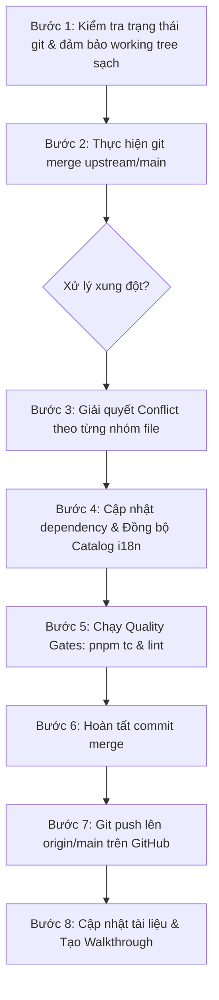

# Kế Hoạch Đồng Bộ & Cập Nhật Từ Upstream Repo (stablyai/orca) [23/10/2026]

> **Trạng thái**: ✅ **ĐÃ HOÀN THÀNH** (Commit merge: `e412fc3180a`)
> **Kết quả**: Đã đồng bộ 3,698 commits từ `upstream/main` vào `main` local và đã push lên `origin/main` trên GitHub.

## 1. Mục tiêu (Goal Description)

Đồng bộ **3,698 commits** mới nhất từ repository gốc (`upstream/main` - `stablyai/orca`) vào nhánh `main` ở môi trường local và đẩy lên GitHub cá nhân (`origin/main` - `https://github.com/covuaduongsinh/orca.git`).

Quá trình này cần bảo toàn 100% các tính năng và cấu hình tùy biến đặc thù của dự án:

1. **Gói ngôn ngữ tiếng Việt (i18n vi)**: Catalog `vi.json`, cấu hình mặc định tiếng Việt, các test case bản địa hóa.
2. **Tính năng Speech-to-Text / Whisper**: Hỗ trợ Groq API key, Whisper Base model catalog, giao diện VoicePane và STT session.
3. **Cấu hình Docker VPS**: `Dockerfile` cho VPS/Dokploy, cấu hình cài đặt agent (Antigravity CLI, Bun, OMP).
4. **Bộ tài liệu kỹ thuật & kế hoạch**: `CLAUDE.md`, `TECH.md`, `MEMORY.md`, `SKILLS.md`, `book/` và các kế hoạch trong `docs/plans/`.

---

## 2. Điểm Cần Chú Ý & Xung Đột Dự Kiến (User Review Required)

> [!IMPORTANT]
> **Khối lượng commit lớn**: Upstream có tới 3,698 commits mới (từ commit `fceca5c` đến `b4ee652`). Một số file test nội bộ đã được upstream xóa bỏ/refactor.

> [!WARNING]
> **Các xung đột (conflicts) đã được quét trước (thông qua `git merge-tree`)**:
>
> - **Modify/Delete conflicts**: `CLAUDE.md` (giữ lại file của HEAD), một số file test (`osc52-clipboard-copy.test.ts`, `locale-english-regression.test.ts`, `native-chat-locales.test.ts`, `settings-status-label-localization.test.ts`, `smart-workspace-jira-locales.test.ts` đã được upstream tái cấu trúc/xóa bỏ -> chấp nhận xóa bỏ theo upstream nếu không còn liên quan).
> - **Content conflicts**:
>   - `src/renderer/src/i18n/locales/*.json`: Nhận thay đổi mới từ `en.json` upstream, sau đó chạy script `sync:localization-catalog` để cập nhật `vi.json`.
>   - `src/renderer/src/i18n/supported-languages.ts`, `src/shared/ui-language.ts`, `src/shared/ui-locale.ts`: Giữ nguyên khai báo hỗ trợ và ưu tiên tiếng Việt.
>   - `src/main/speech/model-manager.ts`, `src/renderer/src/components/settings/VoicePane.tsx`: Giữ nguyên các tích hợp Speech/Whisper/Groq đã bổ sung.
>   - `src/cli/runtime/launch.ts`, `vite.web.config.ts`, `config/localization-coverage-allowlist.json`: Kết hợp logic mới của upstream với cấu hình tùy biến của repo.
>   - `mobile/pnpm-lock.yaml`: Chạy cập nhật dependency sau khi giải quyết conflict.

---

## 3. Quy Trình Thực Hiện (Proposed Changes)



### Nhóm 1: Tài liệu & Cấu hình Repo

- Giữ nguyên:
  - `CLAUDE.md`, `MEMORY.md`, `SKILLS.md`, `TECH.md`
  - Thư mục `book/` (Sổ tay hướng dẫn sử dụng tiếng Việt)
  - Thư mục `docs/plans/` (Lưu trữ toàn bộ các kế hoạch)

### Nhóm 2: Bản địa hóa & Ngôn ngữ tiếng Việt

- Giữ nguyên các đăng ký ngôn ngữ tiếng Việt trong:
  - `src/renderer/src/i18n/supported-languages.ts`
  - `src/renderer/src/i18n/i18n.ts`
  - `src/shared/ui-language.ts`
  - `src/shared/ui-locale.ts`
  - `src/main/i18n/main-i18n.ts`
- Sau khi hợp nhất các file `locales/*.json`, chạy script:
  - `pnpm run sync:localization-catalog`
  - `pnpm run sync:localization-runtime-catalog`

### Nhóm 3: Tính năng Speech / Whisper / Groq & VPS Docker

- Kết hợp thay đổi trong:
  - `src/main/speech/model-manager.ts`
  - `src/renderer/src/components/settings/VoicePane.tsx`
  - `src/cli/runtime/launch.ts`
  - `vite.web.config.ts`
- Đảm bảo các hàm gọi Groq API key, Whisper Base catalog và Web Speech API bridge không bị mất.

---

## 4. Kế Hoạch Xác Minh (Verification Plan)

### Automated Tests

1. **Kiểm tra TypeScript toàn dự án**:
   ```bash
   pnpm tc
   ```
2. **Kiểm tra quy chuẩn mã nguồn trên các file thay đổi**:
   ```bash
   pnpm run check:code-quality:changed
   ```
3. **Kiểm tra hợp đồng Localization**:
   ```bash
   pnpm test src/main/i18n/main-i18n-lazy-locale.test.ts src/renderer/src/i18n/lazy-locale.test.ts
   ```

### Manual Verification

1. Kiểm tra `git log -n 5` xác nhận commit merge đã bao gồm upstream mới nhất.
2. Kiểm tra `git push origin main` thành công, kiểm tra trên giao diện GitHub repo `covuaduongsinh/orca`.
3. Kiểm tra các file tiếng Việt và tính năng tuỳ biến vẫn đầy đủ và nguyên vẹn.
